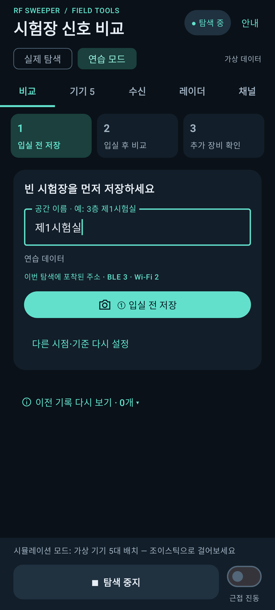
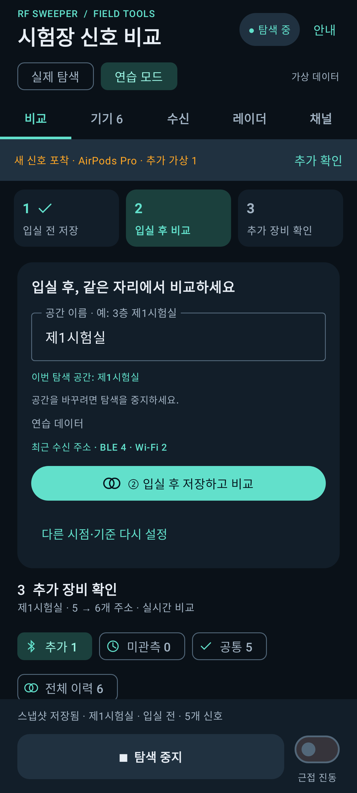
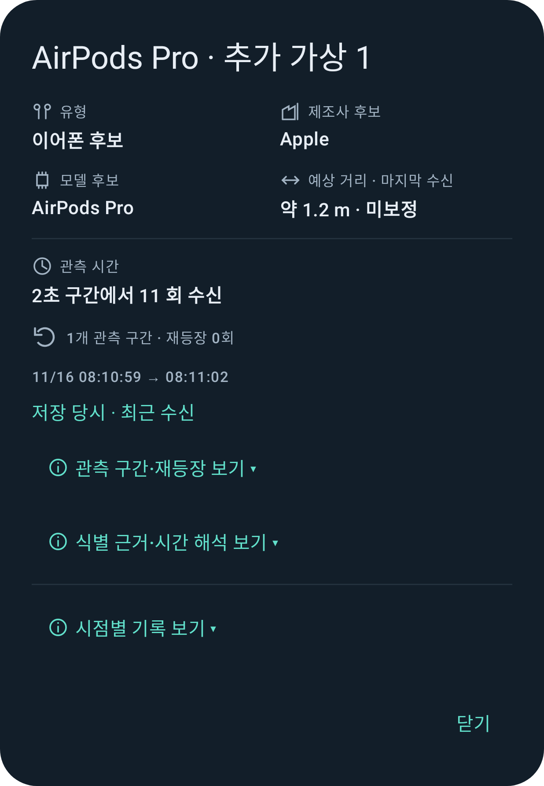
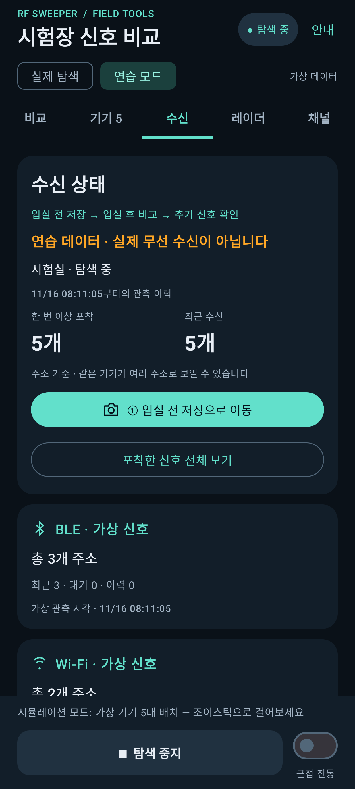
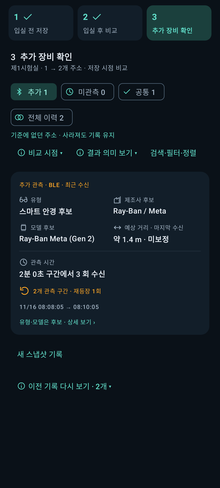
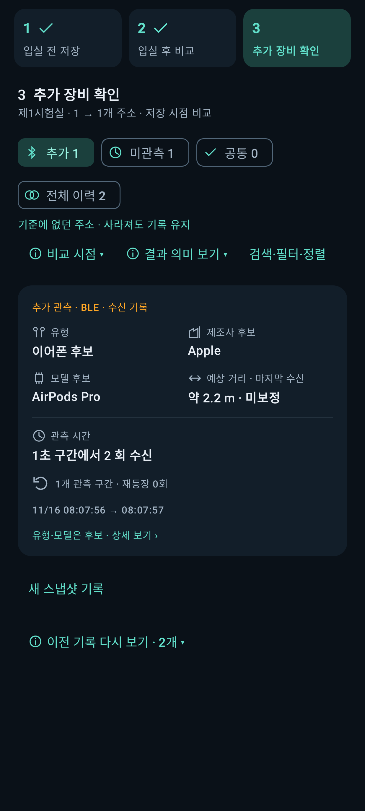
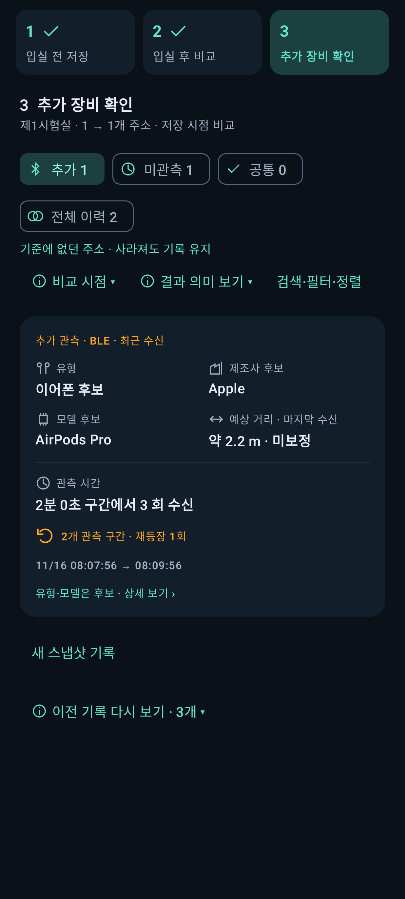
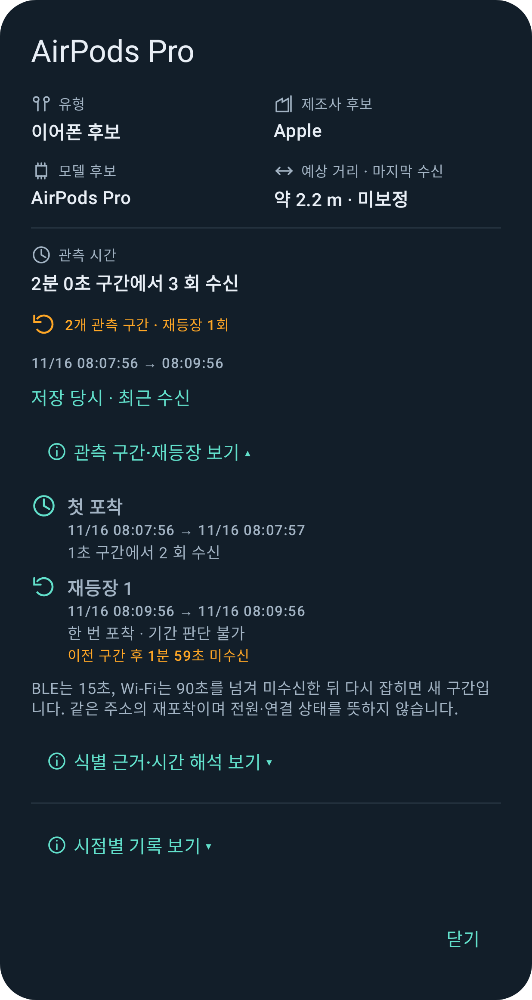

# 처음 사용하는 순서

아래 이미지는 앱의 연습 모드로 실행한 화면입니다. 실제 시험장에서는 `실제 탐색`을 선택하고 권한을 허용하세요. 상단의 1 → 2 → 3 표시에서 현재 단계를 확인할 수 있습니다.

## 1. 입실 전 저장

1. 수험생이 없는 시험장에서 `실제 탐색`을 선택하고 `비교` 탭에서 공간 이름을 입력합니다.
2. 하단 `탐색 시작`을 누릅니다. 첫 자동 보존(5초) 이후에는 공간 이름이 고정됩니다.
3. BLE·Wi-Fi 결과를 기다린 뒤 `① 입실 전 저장`을 누릅니다. Wi-Fi가 0개이면 주변 AP가 없는지, 권한·Wi-Fi·위치 설정 또는 갱신 대기 상태인지 확인하세요.

## 2. 입실 후 비교

수험생 입실 후 같은 자리에서 `② 입실 후 저장하고 비교`를 누릅니다. 앱이 기록 양식을 접고 비교 결과로 이동합니다. 탐색이 중지됐다면 먼저 `탐색 시작`을 누르세요.

## 3. 추가 장비 확인

`추가` 그룹의 장비 카드를 누릅니다. 카드에서 유형, 제조사 단서, 모델 후보와 관측 시간을 확인할 수 있습니다.

| 결과 | 의미 |
| --- | --- |
| 추가 | 기준에 없던 주소를 이후 포착했습니다. 새 물리 기기나 부정행위의 확정 판정은 아닙니다. |
| 미관측 | 기준에는 있지만 이번 자료에는 없는 주소입니다. 기기 전원이나 위치를 확정하지 않습니다. |
| 공통 | 두 시점 모두 기록된 주소입니다. RSSI 변화는 수신 세기의 변화입니다. |

`결과 의미 보기`를 누르면 자세한 설명을 펼칩니다. `검색·필터·정렬`에서 제조사·모델·MAC 검색이나 오디오 후보 필터를 사용할 수 있습니다.

`전체 이력`(겹친 원 아이콘)을 누르면 기준~비교 사이 수동·자동 보존 자료에 한 번이라도 등장한 주소의 합집합을 봅니다. 사라진 주소도 남으며 같은 주소를 여러 번 세지 않습니다. 다른 시험실·연습 모드·비교 이후 자료는 섞지 않습니다.

입실 전 기준은 이번 탐색에서 잡힌 주소 전체입니다. 기준 저장 직전에 사라진 시설 신호도 기준에 남습니다.

## 4. 장비 상세 읽기

- **유형·제조사·모델**: 수신 정보에 근거한 후보입니다. 이름과 광고 회사 코드가 제품을 인증하지 않습니다. 판별할 수 없으면 미확인으로 표시합니다.
- **관측 시간**: 이번 탐색의 최초~마지막 수신 구간과 수신 횟수입니다. 계속 연결된 시간이 아니며 수신 사이의 공백은 알 수 없습니다. 한 번만 받으면 기간 판단 불가입니다.
- **재등장**(되돌아오는 화살표): `관측 구간·재등장 보기`에서 첫 포착과 재포착, 각 구간 사이 미수신 시간을 봅니다. BLE 15초·Wi-Fi 90초를 초과해 수신되지 않았다가 같은 주소를 다시 받으면 새 구간입니다.
- **예상 거리**(양방향 화살표): 마지막 수신 세기의 모델 추정값입니다. `미보정`은 기기별 1m 기준값이 없어 가정값을 썼다는 뜻입니다. 벽·인체·송신 출력 때문에 실제 거리와 크게 다를 수 있고, 수신 기록의 거리는 현재 위치가 아닙니다. 상세 해석에서 계산 가정과 범위를 확인합니다.
- **식별 근거·시간 해석 보기**: 원본 주소, 광고 회사와 모델 해석 근거, 수신 세기의 의미를 펼칩니다.
- **시점별 기록 보기**: 저장된 시점마다 같은 주소가 관측됐는지 확인합니다.

다음 비교는 `새 스냅샷 기록`, 예전 자료는 `이전 기록 다시 보기`를 누릅니다. 다른 시험실을 측정하려면 탐색을 중지하고 공간 이름을 바꾼 뒤 새 탐색을 시작하세요.

## 수신 확인과 자동 보존

`수신 상태` 탭에서 BLE·Wi-Fi 각각의 마지막 수신/완료 시각과 오류를 확인합니다. 첫 결과를 기다리는 상태와 완료된 결과 0개를 구분합니다. 연습 데이터는 실제 수신과 분명하게 표시됩니다.

5초마다, 그리고 정상적으로 탐색을 중지할 때 누적 신호를 자동 보존합니다. `이전 기록 다시 보기`의 `자동 보존 · 전체 수신 이력`에서 다시 비교할 수 있습니다. 앱 밖에서는 수신이 멈추며, 강제 종료 직전 아직 저장하지 못한 구간은 남지 않을 수 있습니다.

안경·시계·카메라 아이콘은 광고 이름에서 읽은 유형 후보입니다. 회사 코드만으로 해당 유형을 정하지 않습니다. 기기 탭의 `웨어러블 후보`나 이름 검색으로 찾을 수 있습니다.

## 전파 기록 파일 저장

비교 결과에서 `비교 시점`을 펼치고 `전파 기록 파일로 저장`을 누른 뒤 파일 위치를 선택합니다. 추가·미관측·공통, 전체 주소 합집합, 각 관측 구간과 거리 추정 근거를 텍스트로 저장합니다. 저장 버튼을 누른 시점의 내용이 고정됩니다.

## 잠깐 등장했다 돌아오는 예시

자동화된 관측 자료를 Android UI에 넣어 검증한 화면입니다. 실기기 수신 화면은 아닙니다.

